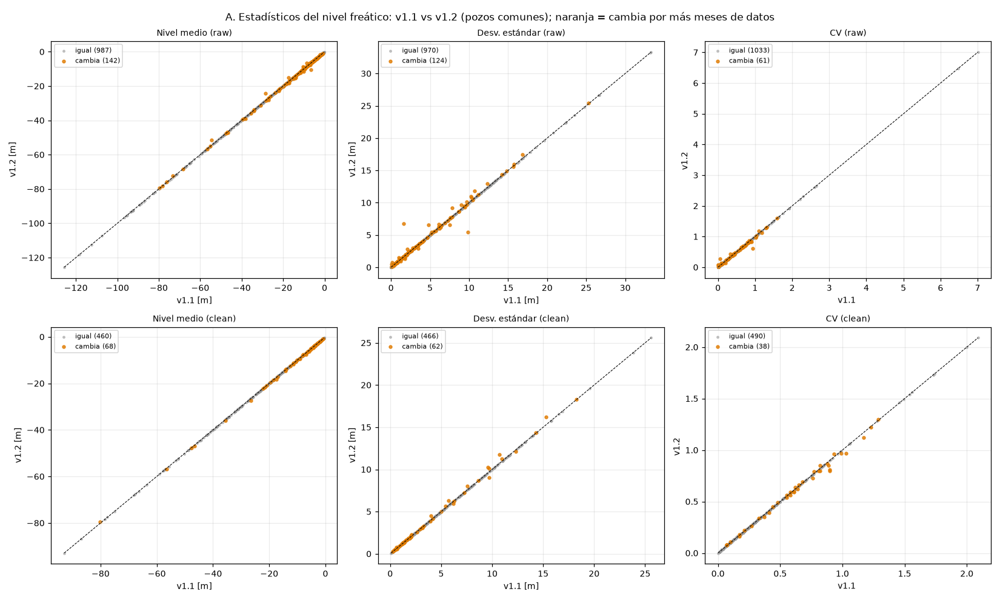
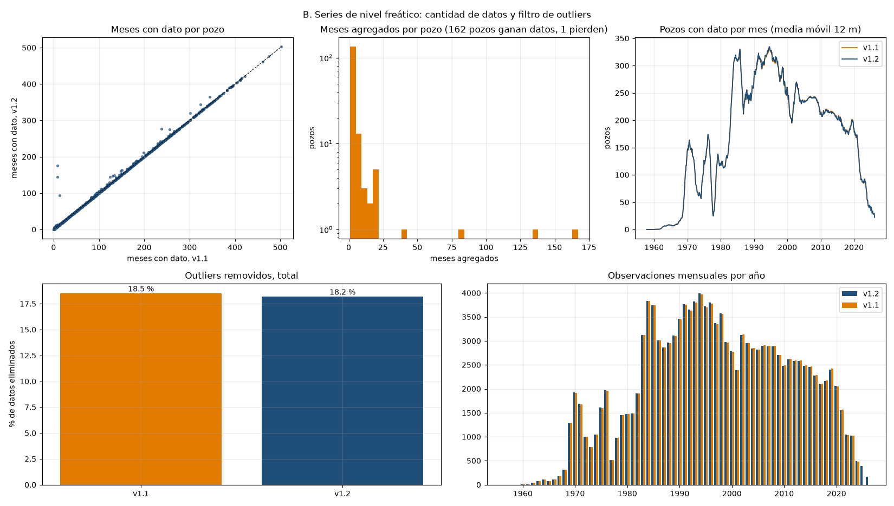
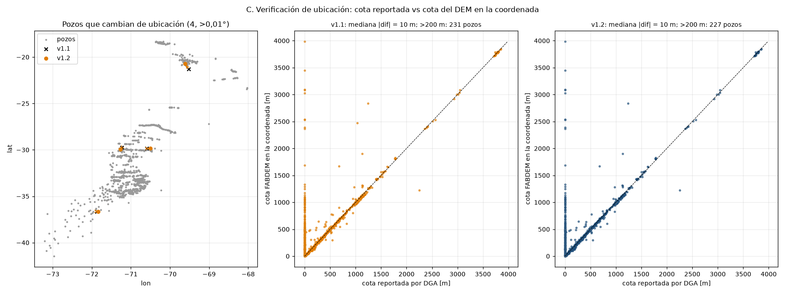
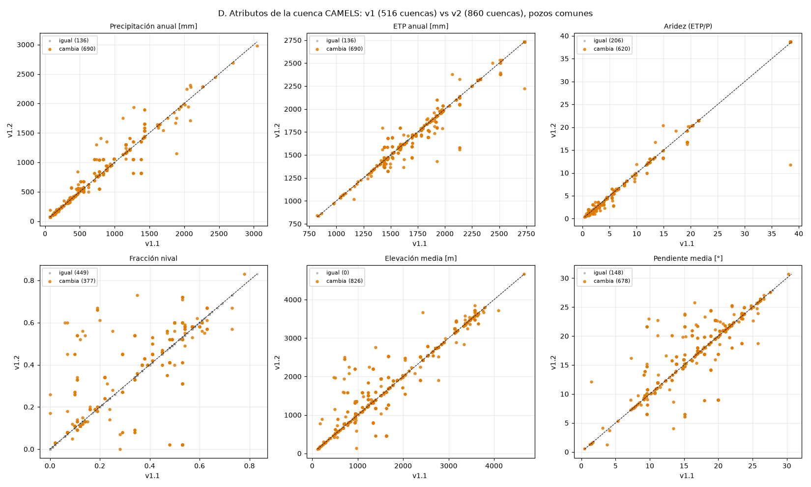
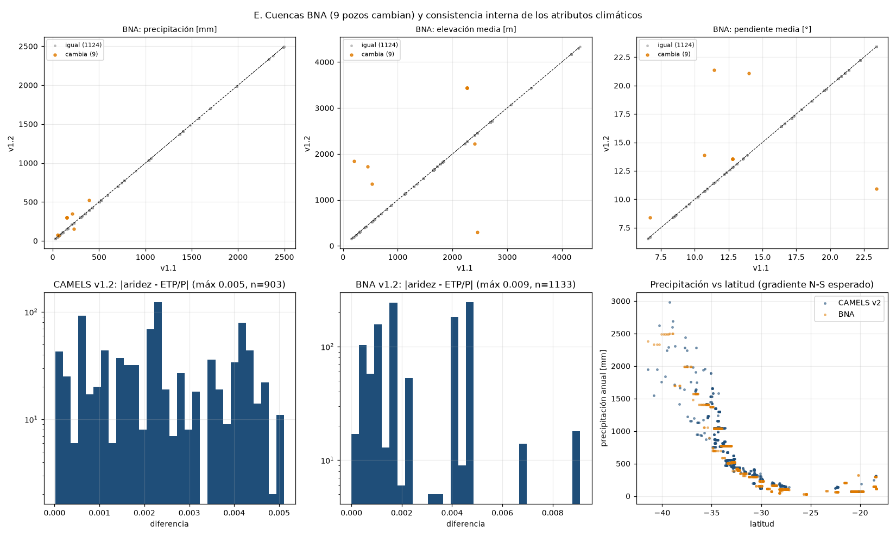
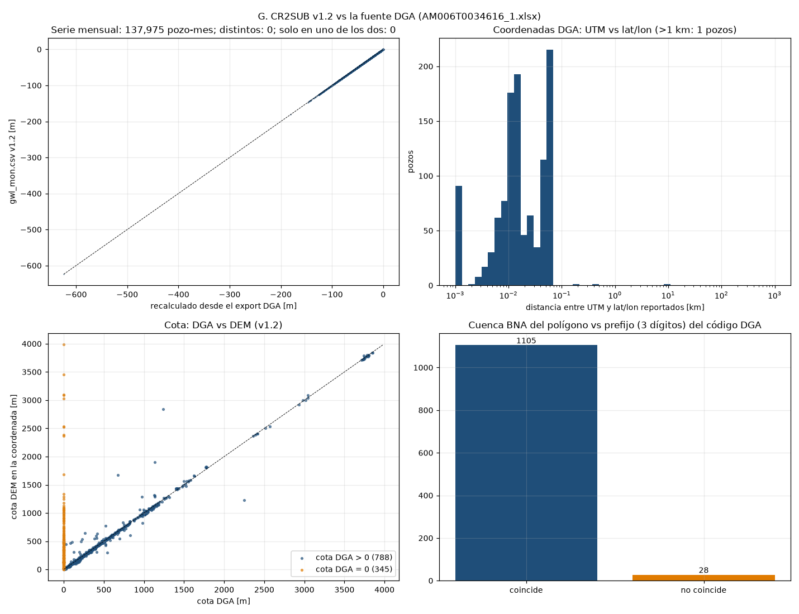
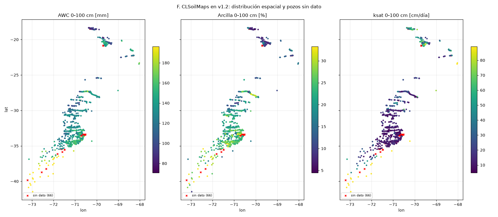

# Evidencia de revisión — migración de input de niveles DGA

## Versiones comparadas

| | v1.1 (referencia) | v1.2 (esta rama) |
|---|---|---|
| Rama | `cr2sub_v1.1` | `cr2sub_v1.2` |
| Input DGA | 844 reportes `dga_xls_*` por pozo | export único `AM006T0034616_1.xlsx` |
| Carpeta de outputs | `versions/v1.1/` | `versions/v1.2/` |

Los CSV de cada carpeta llevan la versión en el nombre
(`cr2sub_v1.1_*` y `cr2sub_v1.2_*`), según la variable `version` de los
scripts de cada rama. Los resultados de
la comparación (v1.1 → v1.2) están en `comparison_v1.1_vs_v1.2/`.

**Objetivo:** reemplazar `input/DGA_GWL_obs_descarga/dga_xls_*` (844 reportes
individuales por pozo, descargados manualmente del portal DGA en 3 tandas)
por el archivo único `input/DGA_GWL_obs_descarga/AM006T0034616_1.xlsx`
(export tabular largo, 147.180 filas, 1 fila por pozo-fecha-valor).

**Scripts modificados:** [`scripts/01_consolidate.R`](../scripts/01_consolidate.R),
[`scripts/functions/functions_consolidate_cr2sub.R`](../scripts/functions/functions_consolidate_cr2sub.R)
(nueva función `deg2dec_compact` para el formato de coordenadas del nuevo
archivo). De paso se corrigió un bug preexistente, no relacionado a la
migración, en [`scripts/03_process_attributes.R`](../scripts/03_process_attributes.R)
(`cuencas_BNA.shp` → `Cuencas_BNA.shp`, mismatch de mayúsculas que impedía
correr el paso 3).

**Método:** se guardó una copia de los 3 outputs de la v1.1 (input
viejo) en `versions/v1.1/` antes de tocar nada, se corrió el
pipeline completo (`01_consolidate.R` → `02_remove_outliers.ipynb` →
`03_process_attributes.R`) con el input nuevo, y se comparó celda por celda
contra la v1.1 con [`scripts/compare_outputs.py`](scripts/compare_outputs.py)
(reproducible, ver sección "Cómo reproducir" abajo). Los resultados de esa
comparación quedan en `comparison_v1.1_vs_v1.2/`.

# Parte I — Comparación entre versiones (v1.1 vs v1.2)

## I.1 Cobertura de pozos

| | Pozos v1.1 | Pozos v1.2 | En común |
|---|---|---|---|
| `gwl_mon.csv` / `gwl_mon_clean.csv` / `attributes.csv` | 1137 | 1133 | 1133 |

La brecha son **4 pozos** que existen en las descargas viejas pero no en el
export único nuevo (`comparison_v1.1_vs_v1.2/wells_missing_in_new_source.csv`):

| Código DGA | Nombre | Cuenca | Subcuenca |
|---|---|---|---|
| 02942002-5 | PIQUE AV-1 | QS. entre Q. La Negra y Q. Pan de Azúcar | Quebrada de Taltal |
| 02942008-4 | PIQUE AV - 42 | QS. entre Q. La Negra y Q. Pan de Azúcar | Quebrada de Taltal |
| 02942011-4 | ESSAN AV - 48 | QS. entre Q. La Negra y Q. Pan de Azúcar | Quebrada de Taltal |
| 02942023-8 | ESSAN AV - 48 | QS. entre Q. La Negra y Q. Pan de Azúcar | Quebrada de Taltal |

Los 4 pertenecen a la cuenca de Taltal (prefijos ESSAN y PIQUE AV).

No hay pozos en el archivo nuevo que no existieran antes (0 pozos nuevos
"de más").

## I.2 Metadatos

De los 1133 pozos en común, **17 valores de metadata** (en 13 pozos)
difieren en más de 0.01 entre el input viejo y el nuevo
(`comparison_v1.1_vs_v1.2/metadata_diffs.csv`):

| cr2sub_id | Nombre | Campo | v1.1 | v1.2 |
|---|---|---|---|---|
| 1700042 | SALAR BELLAVISTA | lat | -21.305833 | -20.734444 |
| 1700042 | SALAR BELLAVISTA | lon | -69.520278 | -69.618056 |
| 1700042 | SALAR BELLAVISTA | elev | 946 | 970 |
| 4400037 | PARCELA 48 CUATRO ESQUINAS | lat | -29.731944 | -29.918889 |
| 4400037 | PARCELA 48 CUATRO ESQUINAS | lon | -71.230278 | -71.269722 |
| 4308010 | POZO CALVARIO | lon | -70.594722 | -70.502778 |
| 8114002 | POZO COIHUECO en Internado Municipal | lon | -71.871667 | -71.838056 |
| 1700051/057/076/099-106 (JICA, 9 pozos) | — | elevación | — | -25 a -35 m |

Los valores difieren entre las dos fuentes y se usa el que trae cada una. El
formato de coordenadas del archivo nuevo (`DDDMMSS` compacto) es uniforme en
los 1134 pozos.

Las métricas agregadas `cr2sub_mean_gwl` y `cr2sub_sd_gwl` cambian en 142 y
124 pozos (I.6).

## I.3 Series: extensión temporal

**Rango de fechas:**

| Archivo | v1.1 | v1.2 |
|---|---|---|
| `gwl_mon.csv` | 1957-04 → 2024-12 (813 meses) | 1957-04 → 2026-08 (833 meses) |
| `gwl_mon_clean.csv` | igual | igual |

Ejemplo concreto — pozo `5423019` (el de mayor cobertura reciente), serie
mensual completa (`cr2sub_v1.2_gwl_mon.csv`), generada con
[`scripts/plot_series_extension.py`](scripts/plot_series_extension.py):


En azul, el registro que ya existía con el input viejo: 344 meses entre
1974-04 y 2024-12 (los cortes de la línea son huecos reales de medición, no
artefactos del gráfico). En naranja, los 20 meses que agrega la
actualización, de 2025-01 a 2026-08, enganchados directo a la cola del
registro existente — no hay reescritura del histórico, solo extensión hacia
adelante. Todos los puntos del tramo en común entre ambas fuentes (hasta
2024-12) son idénticos; el detalle completo de celdas que antes eran `NA` y
ahora tienen valor está en `comparison_v1.1_vs_v1.2/gwl_mon_gap_filled.csv` (420 en
`gwl_mon.csv`, 840 en `gwl_mon_clean.csv`, repartidas en huecos intermedios
de otros pozos además de esta cola).

## I.4 Cobertura mensual por región, 2020–2026

Número de pozos con dato en cada mes, por región (norte a sur), para v1.1
y v1.2 con la misma escala de color. La región de cada pozo se asigna por
ubicación (cruce espacial con los límites regionales; el polígono más
cercano si el punto cae fuera), no por el código DGA, cuyo prefijo es la
macrocuenca BNA y no la región. El panel superior (total mensual) superpone ambas
versiones: v1.2 en azul grueso y v1.1 en naranja fino. Generado con
[`scripts/plot_coverage_by_region.py`](scripts/plot_coverage_by_region.py).


- Hasta dic-2024 las dos versiones son prácticamente idénticas; la línea
  naranja corre dentro de la azul.
- Desde 2025 solo v1.2 tiene datos (hasta ago-2026), concentrados en
  Valparaíso, Tarapacá, Coquimbo y O'Higgins. Las demás regiones no
  aportan meses nuevos.
- En pozos presentes en ambas versiones, v1.2 suma 600 pozos-mes en
  2020–2026 (557 desde 2025 y 43 de huecos rellenados antes) y pierde 1.
  Por región: Valparaíso 362, Tarapacá 127, Coquimbo 63, O'Higgins 43,
  Arica y Parinacota 3, Maule 2.
- Los otros 21 pozos-mes que v1.2 no tiene en el periodo corresponden a
  los 4 pozos privados de Taltal que no están en el export nuevo (I.1).
- La cobertura cae desde ~2020 en ambas versiones y las regiones al sur de
  O'Higgins casi no tienen datos desde 2021–2023.

## I.5 Consistencia de valores de las series

Comparando las **921.129 celdas** (pozo × fecha) presentes en ambas fuentes
en `gwl_mon.csv`:

| v1.1 → v1.2 | Cantidad |
|---|---|
| Valores idénticos o ambos `NA` | 920.708 |
| `NA` antes → con valor ahora (hueco rellenado) | 420 |
| Con valor antes → `NA` ahora (dato perdido) | 1 |
| **Valores contradictorios** (mismo pozo/fecha, valor distinto) | **0** |

El único dato "perdido" es el pozo `1700028` en 2024-04
(`comparison_v1.1_vs_v1.2/gwl_mon_lost.csv`). En `gwl_mon_clean.csv` (post
remoción de outliers) las cifras son 16 perdidos y 840 rellenados.

**Resultado:** cero conflictos de valor en unos 920 mil puntos comparados;
el export único tiene los mismos valores donde coincide con las descargas
viejas y más puntos donde había huecos, salvo los 4 pozos de Taltal que no
están en él.

## I.6 Atributos columna a columna

Generado con [`scripts/compare_attributes.py`](scripts/compare_attributes.py)
(`comparison_v1.1_vs_v1.2/attribute_column_diffs.csv`). De las 45 columnas de
`attributes.csv`, solo `cr2sub_id` es idéntica; los cambios se agrupan así:

| Grupo | Pozos que cambian | Observación |
|---|---|---|
| `dga_well_basin` / `subbasin` / `name` | 1133 / 712 / 45 | El texto cambia de formato (`RIO COPIAPO` → `R.  Copiapo`; `EL TRANSITO` → `POZO EL TRANSITO`) |
| Coordenadas y cota `dga_*` / `cr2sub_*` | 14 a 33 según columna | Ver I.2; `cr2sub_elev` y `cr2sub_slp` cambian en 14 pozos |
| `cr2sub_mean/sd/cv_gwl` (raw y clean) | 61 a 142 | Ver I.3 e I.5 |
| `cr2sub_*camels*` | 273 cambian de cuenca, 77 pasan de NA a tener cuenca, 1 pasa a NA | CAMELS-CL v1 (516 cuencas) → v2 (860 cuencas) |
| `cr2sub_*bna*` | 9 | Nuevo criterio: cuenca que contiene al pozo, con buffer de 500 m solo si no cae en ninguna (antes el buffer se aplicaba a todos los pozos) |
| `cr2sub_clsoilmap_*` | 0 | Ver I.8 |

Pozos sin cuenca CAMELS: 310 en v1.1 → 230 en v1.2. El pozo `5221007`
(PAPUDO Y ZAPALLAR, mismas coordenadas) tenía cuenca CAMELS en v1 y no en v2.

## I.7 Figuras comparativas de atributos

Figuras generadas con [`scripts/compare_plots.py`](scripts/compare_plots.py) (`comparison_v1.1_vs_v1.2/fig_*.png`).

**A. Estadísticos del nivel.** El nivel medio cambia en 142 pozos (mediana
0,05 m, máximo 4,2 m).



**B. Series y filtro de outliers.** 162 pozos ganan meses (mediana 2,
máximo 167) y 1 pierde. El filtro elimina el 18,5 % de los datos en v1.1 y
el 18,2 % en v1.2. 598 de los 1133 pozos tienen menos de 100 meses con dato
y quedan sin datos en `gwl_mon_clean.csv` (`min_obs = 100`); en los 535
restantes se elimina el 3,35 %.



**C. Ubicación y cota.** Diferencia entre la cota reportada por la DGA y la
del DEM en la coordenada del pozo, para los 4 pozos que cambian de
ubicación (v1.1 → v1.2): `4308010` 1445 m → 9 m, `4400037` 211 m → 2 m,
`1700042` 145 m → 4 m, `8114002` 3 m → 1 m. 345 pozos reportan cota 0 en
ambas versiones. Hay 227 pozos con diferencia mayor a 200 m en v1.2 (15 si
se excluyen los de cota 0); la mediana de |diferencia| es 9,8 m.



**D. Cuencas CAMELS.** De los 553 pozos que mantienen el mismo `gauge_id`,
cambian elevación (mediana 4,9 m, p95 58 m) y precipitación (mediana
0,35 mm, p95 29 mm). En los 273 pozos que cambian de cuenca, la mediana de
la diferencia es 254 m de elevación y 63 mm de precipitación.



**E. Cuencas BNA.** 9 pozos BNA cambian de cuenca (paneles superiores).



## I.8 CLSoilMaps entre versiones

**v1.1 vs v1.2.** Los valores de suelo son idénticos en 1131 de los 1133
pozos comunes. Los otros 2 son los pozos nuevos (`05120007` y `05120011`) que
v1.1 tenía en NA y que ahora se extrajeron de los rasters. Pozos con suelo en
NA: 66 de 1133 (fuera de la cobertura de CLSoilMaps).

**Pozos con coordenadas cambiadas.** Los tres pozos con mayor diferencia
entre el valor guardado y la re-extracción son `4308010`, `1700042` y
`8114002`, que cambiaron de coordenadas entre v1.1 y v1.2 (I.2); su
valor guardado es idéntico al de v1.1. El cuarto pozo con coordenadas
cambiadas, `4400037`, tiene valor guardado (AWC 0-100 cm: 94,7 mm) y la
re-extracción da NA. `6011022` y `4400017` están en NA en el valor guardado
y tienen dato en la re-extracción (136,7 y 124,4 mm).

# Parte II — Comparación con la DGA (solo v1.2)

Se compara `cr2sub_v1.2_*` con el export de la DGA del que sale
(`AM006T0034616_1.xlsx`), recalculando en Python, de forma independiente del
pipeline en R, las series mensuales y las coordenadas. No interviene v1.1.
Script: [`scripts/compare_vs_dga.py`](scripts/compare_vs_dga.py); salidas en
`comparison_v1.1_vs_v1.2/vs_dga_*.csv` y `fig_g_vs_dga.png`.

## II.1 Pozos y registros

El export tiene 147.180 filas; 358 no tienen código de estación y quedan
fuera. De las 146.822 restantes, 7.951 tienen valor menor o igual a 0 y no
entran a las series. El export tiene 1.133 pozos y `attributes` de v1.2
tiene los mismos 1.133.

## II.2 Series mensuales

Se recalcula la serie mensual con las reglas del paso 01: promedio de las
mediciones repetidas de un mismo pozo y fecha, descarte de valores menores o iguales a 0,
promedio mensual y signo invertido. En las 137.975 celdas pozo-mes con dato
en ambas fuentes hay 0 diferencias (máximo 2,8e-14 m) y ninguna celda tiene
dato solo en una de las dos.

## II.3 Coordenadas

- Las coordenadas del export (`DDDMMSS`), convertidas de forma
  independiente, coinciden con `dga_well_lat` y `dga_well_lon` (diferencia
  máxima 4,4e-7°).
- `cr2sub_lat` y `cr2sub_lon` son iguales a las de la DGA en los 1.133 pozos.
- UTM y lat/lon reportados por la DGA: mediana de la distancia 0,015 km;
  1 pozo supera 1 km (`4320007`, 9,0 km). Para 39 pozos el huso 18 ajusta
  mejor que el 19 (la DGA no informa el huso).

## II.4 Cota

345 pozos tienen cota 0 en el export. En los otros 788 la mediana de
|cota DEM − cota DGA| es 6,2 m y 15 pozos superan los 200 m
(`vs_dga_elev_gt200m.csv`).

## II.5 Cuenca BNA

El código BNA del polígono que contiene al pozo coincide con los primeros 3
dígitos del código DGA en 1.105 de 1.133 pozos; en 28 difiere
(`vs_dga_bna_prefix_mismatch.csv`; 10 de ellos con prefijo 42 y polígono 43).



# Parte III — Otras verificaciones de v1.2

Ni entre versiones ni contra la DGA.

## III.1 CLSoilMaps

Scripts: [`scripts/validate_clsoilmaps_extraction.R`](scripts/validate_clsoilmaps_extraction.R)
(re-extrae el suelo de todos los pozos con los rasters originales) y
`compare_attributes.py`. Salidas: `clsoilmaps_*.csv` y
`clsoilmaps_stored_vs_reextracted.png` en `comparison_v1.1_vs_v1.2/`.

**Coherencia espacial.** Para cada pozo y su vecino más cercano a menos de
5 km (884 pares), la correlación del valor de suelo es 0,77 a 0,95 (por
ejemplo arena 0-100 cm: 0,95; arcilla 0-100 cm: 0,92), frente a ~0 para
pares al azar. Los dos pozos nuevos tienen AWC 0-100 cm de 130 y 126 mm;
sus tres vecinos más cercanos van de 120 a 139 mm.

**Verificaciones físicas.** Sin valores negativos y densidad aparente entre
0,7 y 2,0 g/cm³ en todos los pozos. Hay 9 pozos con arcilla + arena > 100 %
en 100-200 cm.

**Re-extracción vs valores guardados** (1066 pozos con dato en ambos):
correlación 0,997 a 0,999; mediana de la diferencia relativa 0,06 % a 0,5 %.
Entre 106 y 598 pozos por variable son idénticos al milésimo; la mediana de
la diferencia en AWC 0-100 cm es 0,1 mm (mediana de la variable: 136 mm).

**F. CLSoilMaps.** Mapa de AWC, arcilla y ksat; 66 pozos sin dato (cruces
rojas). La comparación numérica está en I.8 y III.1.



## III.2 Consistencia de los atributos climáticos

La diferencia máxima entre la aridez y ETP/P es 0,005 (CAMELS) y 0,009 (BNA). La fracción nival está dentro de [0, 1] en todos los pozos. La precipitación disminuye de sur a norte (panel inferior de la figura E, en I.7).

## III.3 Pipeline

Corrida completa con el input nuevo (`main_pipeline.py`: 01 → 01b → 02 → 03).
Las salidas coinciden con las secciones I.1 a I.5; los CSV de `versions/v1.2/` son
copia de `cr2sub/`. La asignación a cuencas ahora se regenera con
`input/cr2sub_basin_lookup_tables/lookup_table_script.R` (intersección
vectorial, sin dependencias externas).

# Cómo reproducir

Todo junto (tras `main_pipeline.py`): `review_dga_xlsx_migration/scripts/regenerate_review.sh`. Por partes:

```bash
cd review_dga_xlsx_migration/scripts
python3 compare_outputs.py        # series y metadatos; solo stdlib
Rscript ../../review_dga_xlsx_migration/scripts/validate_clsoilmaps_extraction.R   # desde la raíz del repo
python3 compare_attributes.py     # atributos y CLSoilMaps; pandas, matplotlib
python3 compare_plots.py          # figuras A-F; pandas, matplotlib
python3 compare_vs_dga.py         # Parte II, contra el export DGA; openpyxl, pyproj
python3 plot_series_extension.py; python3 plot_coverage_by_region.py   # figuras; geopandas
```

Lee de `../versions/{v1.1,v1.2}/*.csv` y escribe a
`../comparison_v1.1_vs_v1.2/`. Para regenerar `versions/v1.2/` desde cero, correr el
pipeline (`scripts/main_pipeline.py`, requiere pandas para el paso 02)
y copiar los 3 CSV de `cr2sub/` ahí.
